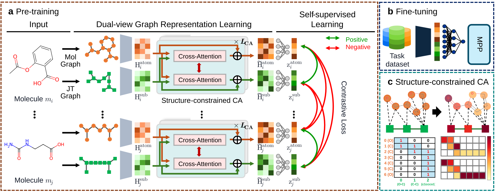

# SJoINT

**S**ubstructure-Driven **J**uncti**o**n Tree for **INT**erpretable Molecular Property Prediction.

SJoINT learns molecular representations from two complementary views of each
molecule — an **atom-level molecular graph** and a **substructure-level junction tree (JT)** —
fused by **structure-constrained bidirectional cross-attention** and pre-trained
with an augmentation-free contrastive objective (NT-Xent). The pre-trained
backbone is then fine-tuned for downstream **molecular property prediction**, and the
structure-constrained attention makes the atom ↔ substructure interactions
interpretable.



*Overview. **(a)** Augmentation-free contrastive pre-training of the dual-view
(molecular-graph and JT) backbone. **(b)** Fine-tuning of the pre-trained backbone
with a task-specific prediction head for molecular property prediction (MPP).
**(c)** Structure-constrained cross-attention between each substructure and its
constituent atoms.*

## Repository layout

```
SJoINT/
├── requirements.txt
├── images/                  # overview figure
├── checkpoints/             # released pre-trained backbone
├── data/                    # raw inputs + vocabulary (processed tensors git-ignored; see data/README.md)
├── preprocess/              # raw SMILES/CSV → .pt tensors
│   ├── core/                #   shared featuriser & I/O
│   ├── pretrain/            #   vocab builder + ZINC250K tensorizer
│   ├── moleculenet/         #   downstream split + tensorizer
│   └── moleculeace/         #   activity-cliff (MoleculeACE) tensorizer
├── pretrain/                # backbone pre-training
│   ├── model.py             #   SJoINTModel (Mol/JT encoders + cross-attention)
│   ├── utils.py             #   dataset, collate, contrastive (NT-Xent) loss
│   └── train.py             #   pre-training entry point
└── finetune/                # downstream fine-tuning
    ├── model.py             #   DownstreamModel (backbone + MLP head) + loader
    ├── dataset.py           #   dataset, collate, cross-attention mask
    ├── engine.py            #   shared training engine (two-stage loop, metrics)
    ├── moleculenet/         #   MoleculeNet benchmark (train.py, configs.py)
    └── moleculeace/         #   MoleculeACE activity-cliff benchmark (van Tilborg protocol)
```

## Install

```bash
conda create -n sjoint python=3.12 -y && conda activate sjoint
pip install -r requirements.txt
# torch-scatter / torch-sparse: match your torch+CUDA build, e.g.
pip install torch-scatter==2.1.2 torch-sparse==0.6.18 \
    -f https://data.pyg.org/whl/torch-2.8.0+cu128.html
```

## Workflow

The included `data/` ships the **raw** inputs (SMILES, MoleculeNet and MoleculeACE
CSVs) and the JT vocabulary used by the released backbone. The large **processed
tensors** are *not* committed — build them locally with the preprocessing step
below (see also `data/README.md`).

Two routes are supported:

- **Released backbone** — use `data/vocab/vocab_zinc.json` and
  `checkpoints/SJoINT_zinc250k_pretrained.pt`; skip step 2.
- **New backbone** — build a new JT vocabulary, tensorize everything with it, and
  pre-train (step 2). Vocabulary ids index the backbone's substructure embeddings,
  so a backbone must always be used with the vocabulary it was pre-trained with.

### 1. Preprocess
See `preprocess/README.md` for all options.
```bash
# Released vocabulary
bash preprocess/run.sh pretrain                     # ZINC250K → .pt chunks
bash preprocess/run.sh moleculenet                  # MoleculeNet random split (seed 42)
MODE=scaffold bash preprocess/run.sh moleculenet    # MoleculeNet scaffold split
bash preprocess/run.sh moleculeace                  # MoleculeACE fixed splits

# New vocabulary: set VOCAB_PATH to a new file (built on the first call)
export VOCAB_PATH=data/vocab/vocab_new.json
bash preprocess/run.sh pretrain
bash preprocess/run.sh moleculenet                  # ... and the other datasets
```

### 2. Pre-train the backbone
```bash
python pretrain/train.py \
    --data_path data/processed/zinc250k --vocab_path data/vocab/vocab_new.json \
    --checkpoint_dir checkpoints/backbone \
    --learning_rate 1e-4 --temperature 0.07 --batch_size 256 --weight_decay 5e-5 \
    --warmup_epochs 10 --max_epochs 100 --num_workers 4 --seed 42
```
The model architecture is fixed to the released backbone (defined by `SJoINTModel`
defaults in `pretrain/model.py`); only training hyper-parameters are on the CLI.
Produces `checkpoints/backbone/best_model.ckpt`, selected by held-out contrastive
loss. Training is seeded for reproducibility.

A ready-to-use pre-trained backbone is included:
**`checkpoints/SJoINT_zinc250k_pretrained.pt`** (ZINC250K, used with
`data/vocab/vocab_zinc.json`). Load it directly to skip pre-training.

### 3. Fine-tune
**MoleculeNet** — two-stage downstream prediction (head warm-up → end-to-end
fine-tune; best epoch by validation loss):
```bash
python finetune/moleculenet/hp_search.py --dataset BBBP    # optional: per-dataset HP by validation loss
python finetune/moleculenet/train.py --dataset BBBP --seed 42 \
    --pretrain_ckpt checkpoints/SJoINT_zinc250k_pretrained.pt
```
**MoleculeACE** — the activity-cliff benchmark uses the same backbone but its own
protocol (van Tilborg 2022): a fixed train/test split; the training set split into
5 folds stratified by median-binarized activity; hyper-parameters selected by
Gaussian-process Bayesian optimization (at most 50 combinations) scored by this
cross-validation; and one model per fold (early stopping on the held-out fold)
evaluated on the fixed test set, reporting RMSE + RMSE_cliff averaged over the
five fold models:
```bash
python finetune/moleculeace/hp_search.py --task CHEMBL204_Ki             # 5-fold CV Bayesian HP search
python finetune/moleculeace/train.py     --task CHEMBL204_Ki --fold 0    # one fold model (repeat for folds 0-4)
python finetune/moleculeace/aggregate.py                                 # average over the fold models
```
See `finetune/README.md` for the schedules, hyper-parameters, and outputs.
`--pretrain_ckpt` defaults to the released backbone; pass
`checkpoints/backbone/best_model.ckpt` to fine-tune a newly pre-trained one.

## Data & citations

SJoINT is pre-trained on **ZINC250K** and fine-tuned on the **MoleculeNet**
benchmarks and the **MoleculeACE** activity-cliff benchmark. Please cite the
original dataset sources when using this repository:

- **ZINC** (pre-training corpus) — Irwin & Shoichet, *ZINC – A Free Database of
  Commercially Available Compounds for Virtual Screening*, J. Chem. Inf. Model.
  45(1):177–182, 2005. https://zinc.docking.org
- **MoleculeNet** (downstream benchmarks: BBBP, BACE, ClinTox, SIDER, Tox21,
  ToxCast, FreeSolv, ESOL, Lipophilicity) — Wu et al., *MoleculeNet: A Benchmark
  for Molecular Machine Learning*, Chemical Science 9:513–530, 2018.
  https://moleculenet.org
- **MoleculeACE** (30 ChEMBL activity-cliff regression tasks; metric RMSE and
  RMSE_cliff) — van Tilborg, Alenicheva & Grisoni, *Exposing the Limitations of
  Molecular Machine Learning with Activity Cliffs*, J. Chem. Inf. Model.
  62(23):5938–5951, 2022. https://github.com/molML/MoleculeACE

The raw inputs shipped under `data/` are redistributed from these public sources
for convenience; all rights remain with the original authors.
